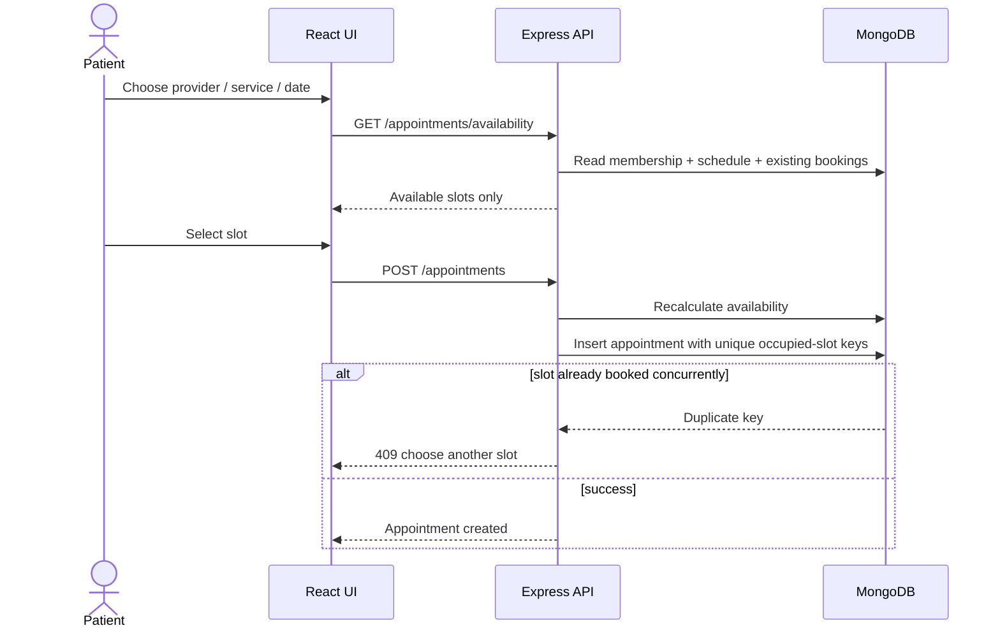

# Appointment Scheduling Architecture

## Why a provider-network model

A healthcare platform cannot model scheduling as only `patient -> doctor -> time`. The same doctor can work at multiple hospitals/clinics, each location can have different working hours, services, prices and consultation modes, and a private doctor should still fit the same model.

## Domain model

1. **Organization**: hospital, clinic, private practice, diagnostic center or telehealth provider.
2. **Location**: a branch/OPD with its own address and timezone.
3. **DoctorMembership**: links a verified doctor to an organization, allowed locations, specialties and bookable services.
4. **Service**: consultation type, duration, fee, currency and allowed modes.
5. **DoctorSchedule**: weekly availability, slot size, buffer time and date exceptions for a doctor/location.
6. **Appointment**: patient, doctor, organization, location, service, start/end, mode and status.

## Booking flow

## Scaling considerations

- Add Redis caching for provider directory and generated availability.
- Partition/search providers by city, specialty and organization.
- Use queue workers for reminders and notifications.
- Synchronize optional Google/Microsoft calendars as additional busy-time sources.
- Add rooms/equipment as bookable resources when procedures require them.
- Use payment/order services separately from the appointment aggregate.
- Keep all times in UTC in appointments; keep an IANA timezone on each location/schedule for presentation and slot generation.
