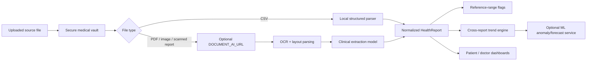

# Unified Medical Report Intelligence

## Goal

The platform stores the original medical file unchanged in the vault and separately maintains a normalized `HealthReport` representation for search, timelines and longitudinal analytics.

## Supported analysis patterns

### Numeric longitudinal analysis

Works for any numeric value that can be reliably extracted, for example:

- CBC, renal, liver, thyroid, lipid and diabetes biomarkers
- urinalysis quantitative values
- blood pressure, pulse, temperature, SpO2, weight
- ECG measurements such as heart rate, PR/QRS/QTc when present
- echo measurements such as LVEF or chamber dimensions
- imaging measurements such as lesion/nodule size when present

The system groups measurements by normalized metric name + unit, plots values over time, compares the latest value with the report-provided reference range, calculates a simple trend and optionally calls the ML service for exploratory anomaly detection/forecasting.

### Narrative report analysis

Radiology, pathology, discharge, ECG/echo impressions and other text-heavy reports are represented using:

- report type, date and provider
- findings
- impression/conclusion
- summary
- extraction provenance and confidence

The current UI provides a longitudinal narrative timeline. A production AI service can additionally perform entity extraction, comparison against the patient's previous report of the same type, and clinician-facing summarization.

## Extraction pipeline

## Safety boundaries

The system must not claim to diagnose disease from a document. AI/OCR output can be wrong, report reference ranges vary by lab and patient context, and treatment decisions require a clinician. Therefore extraction status, provenance, confidence and disclaimers are kept in the report model/UI.
