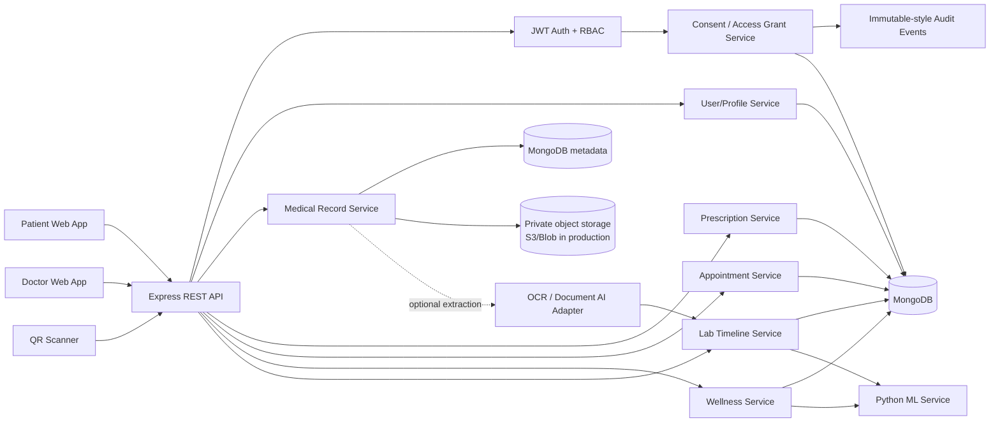
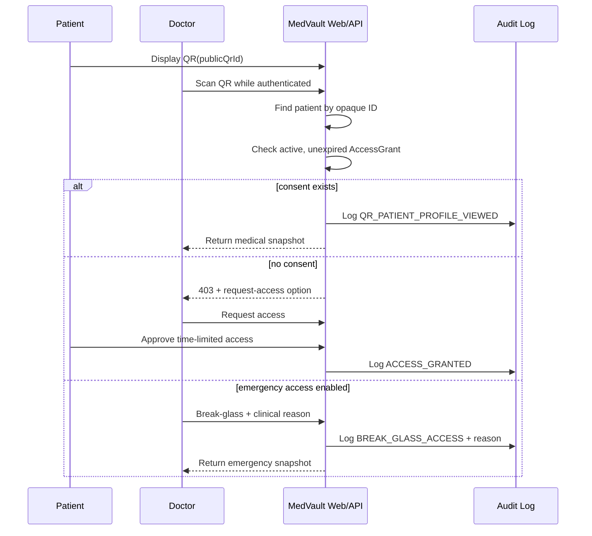
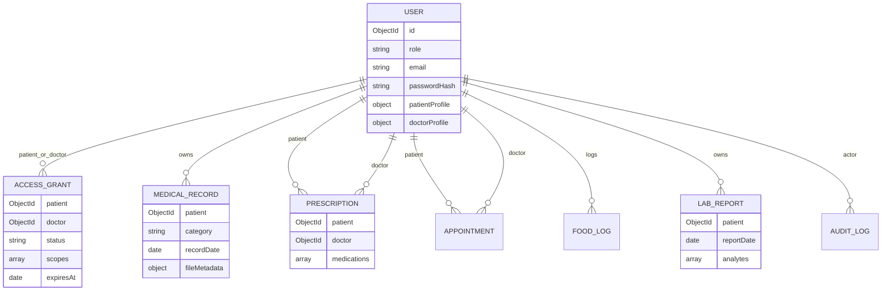

# MedVault System Design

## 1. Problem statement

MedVault is a consent-first personal health record platform. Patients own a longitudinal medical vault; doctors receive time-bound access, can review records after authorization, and can issue digital prescriptions. The same platform also supports appointments, wellness tracking, and longitudinal lab analytics.

The design intentionally separates **storage**, **access control**, **clinical workflows**, and **analytics** so each can scale and be secured independently.

## 2. High-level architecture



### Why MERN + a small Python service?

- React handles patient/doctor dashboards and QR scanning.
- Node/Express is the central API and authorization boundary.
- MongoDB fits evolving health-record metadata and analyte arrays well.
- Python handles the local food-photo model and optional lab trend analysis. The core application still works if ML is unavailable; food-photo estimates require the ML service.

## 3. QR security design

The QR **never contains medical data, email, blood group, diagnosis, or a JWT**. It contains only a random public QR identifier in a MedVault URL.



This is a stronger interview answer than “put all medical information in a QR,” because QR images can be photographed, forwarded, cached, or printed.

## 4. Core data model



## 5. Longitudinal lab analytics

### In this runnable project
1. Patient enters structured analytes or imports CSV.
2. The Node service normalizes each test name and builds a chronological series.
3. It calculates latest reference-range state and a deterministic linear slope.
4. If the Python service is available, it adds linear-regression forecasting and Isolation Forest anomaly candidates.
5. UI charts each test over time.

### Arbitrary PDF/image lab reports in production
A real production system should add an extraction pipeline rather than pretending every laboratory PDF has the same layout:

```text
Private file upload
  -> malware scan
  -> OCR / Document AI
  -> table + key/value extraction
  -> canonical analyte mapper ("Hb", "HGB", "Hemoglobin" -> same concept)
  -> unit normalizer
  -> confidence threshold
  -> human confirmation for low-confidence values
  -> LabReport collection
  -> trend/ML service
```

A provider adapter can use Azure Document Intelligence, AWS Textract, Google Document AI, or an approved clinical document parser. The extracted values should be reviewable before becoming part of a longitudinal chart.

## 6. ML boundary

ML is used only where it adds value:

- Gemini vision (the default provider) identifies visible foods, assigns categories, and estimates a gram range for each food from the image and optional description. When a recipe is uncertain, Gemini also interprets the user's ingredient answer into approximate ingredient shares.
- The local Indian Nutrient Databank supplies matching Indian recipe nutrition; USDA FoodData Central supplies ingredient nutrition when an exact recipe or ingredient is not in the local data. The application, not the model, calculates calories and macros from those values.
- Trend regression / short-horizon extrapolation.
- Unsupervised anomaly candidates for long time series.
- Future OCR/entity extraction from heterogeneous reports.

Food-photo flow: the authenticated Node API validates the upload and requires explicit third-party analysis consent. FastAPI decodes the image, applies EXIF orientation, caps its dimensions, resizes it, and re-encodes it without EXIF metadata. It calls Gemini with structured JSON output by default (or OpenAI if selected in server configuration). The model returns food names, categories, gram estimates, gram ranges, and visual confidence; the prompt forbids it from inventing nutrition values. The provider API key stays in the Node server and is passed to the internal Python service only for that request.

Node first tries an exact local Indian recipe or a high-confidence nutrition record. If no reliable recipe-title match exists, the clarification answer goes to the configured vision model as text. The model returns ingredient names, preparation, estimated grams per 100 g of finished food, confidence, and assumptions; server validation checks the response. Node looks up each ingredient in nutrition data, weights database energy and macros by ingredient shares, then scales the combined values to the image-estimated portion. It saves the ingredient breakdown, database sources, and an uncertainty range with the review, so final confirmation uses the same server-calculated values. It does not reject a useful answer only because no database title uses the same words. If the food or ingredients remain unclear, it asks one focused question. A 4/4/9 macro check flags large differences from database energy. The user can edit gram amounts, search for a different database item, add items, remove false detections, and confirm. The log stores AI grams and names separately from final portions and nutrition sources. Analysis drafts and final logs never store the image.

Portion and ingredient-share estimates from one image and a short description remain uncertain because depth, plate scale, recipe proportions, and cooking oil may not be visible. The UI shows ranges, assumptions, and confidence for review. This is a food-logging aid, not a medical-grade measurement or dietary prescription. Photos, optional descriptions, and clarification answers are sent to the configured vision provider only after consent; food and ingredient names are used for nutrition lookup. Google may use Gemini free-tier content to improve its products.

ML is **not** used for BMI, BMR, TDEE, permissions, reference-range checks, or medication decisions. Those are deterministic/rule-based. This keeps behavior explainable and avoids unnecessary “AI everywhere.”

## 7. Security model

- BCrypt password hashing.
- JWT authentication and route-level RBAC.
- Patient-doctor AccessGrant with expiry.
- Record file access is mediated by API checks; uploads are not publicly exposed.
- Audit records for sensitive reads, grants, uploads, and emergency access.
- File type/size allow-list in the demo.
- QR uses opaque IDs only.
- Break-glass access requires patient opt-in and a reason.

### Production hardening

Use short-lived access tokens + rotating refresh tokens, MFA for clinicians, verified medical-license workflow, encryption-at-rest with KMS, TLS, private object storage with presigned URLs, malware scanning, rate limits, CSP, SIEM export, database backups, audit retention, key rotation, consent versioning, and tenant isolation if used by hospitals.

For a real healthcare deployment, legal/compliance requirements vary by country and product role (for example HIPAA in the U.S. or applicable Indian health-data/privacy requirements). Compliance cannot be claimed from code structure alone.

## 8. Scaling plan

### 10K users
Single Express service, MongoDB replica set/managed cluster, object storage, Redis optional.

### 1M users
- CDN for static React assets.
- Load-balanced stateless API instances.
- Redis for rate limiting, session/permission cache, queues.
- MongoDB sharding by patient/tenant key if required.
- Object storage + lifecycle policy for documents.
- Async jobs for OCR, notifications, analytics and virus scanning.
- Dedicated audit/event pipeline.
- Read models/materialized summaries for doctor dashboard.

## 9. Availability and failure handling

The ML service is non-critical to medical-record workflows. If it is unavailable, core lab charts still work with deterministic Node analytics, but photo-based calorie estimates cannot be created until the service is back. File storage, consent checks and prescriptions never depend on ML availability.

For OCR, use an async queue with retry/dead-letter behavior. The user can still see the original uploaded file while extraction is pending or failed.

## 10. Key trade-offs to discuss in interviews

- **MongoDB vs relational DB:** Mongo is flexible for medical-document metadata, but prescriptions/appointments can also fit PostgreSQL. In a production EHR integration, relational constraints/FHIR storage may be preferable.
- **JWT vs server sessions:** JWT works for stateless scaling; short TTL and refresh-token revocation are required for sensitive systems.
- **Stable QR vs one-time QR:** Stable QR is convenient; a rotating/ephemeral signed QR is more private. This project offsets risk with mandatory server authorization.
- **Synchronous vs async OCR:** async is more resilient and prevents upload latency.
- **ML vs rules:** clinical-looking output must be explainable and conservative; deterministic reference checks remain primary.

## v2 domain expansion

The appointment domain now separates healthcare organizations from users. `Organization` supports hospitals, clinics and private practices with multiple locations. `DoctorMembership` attaches a verified doctor to one organization and defines specialties/services. `DoctorSchedule` publishes location-specific recurring availability and exceptions. `Appointment` persists the selected organization/location/service and uses a unique slot key to reduce double-booking races.

The analytics domain now uses a generalized `HealthReport` model in addition to the original `LabReport` compatibility layer. Original source documents remain in the secure `MedicalRecord` vault while normalized metrics/findings/impressions are stored separately for analytics. This enables cross-report longitudinal metrics and narrative timelines without mutating the source file.

See `APPOINTMENT_ARCHITECTURE.md`, `REPORT_INTELLIGENCE.md`, and `ADMIN_AND_SECURITY.md` for the detailed interview discussion.
